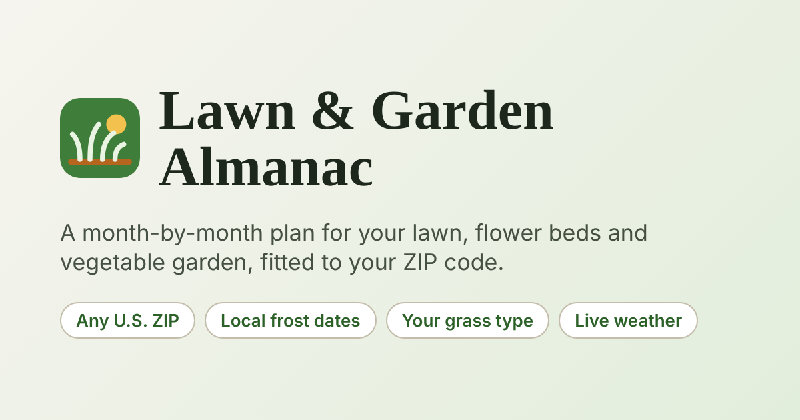

# KC Lawn & Garden Almanac

An interactive, month-by-month plan for a lush, **rain-fed tall fescue lawn**, flower beds and a
vegetable garden in the **Kansas City, MO** area (USDA zone 6b). It runs entirely
in the browser as a static GitHub Pages site. It has no build step, no accounts and no tracking.

Not in Kansas City? Type a ZIP code in the bar at the top. The almanac looks up that area's weather
history, estimates its frost dates and hardiness zone, and shifts every task, planting window and
weather alert to match. It also says so plainly when the tall fescue plan is a poor fit for the
climate.

The plan follows University of Missouri and K-State Extension guidance, backed by recent turf
research. Every task links to its sources and shows how strong the evidence is: Extension,
peer-reviewed, product label, vendor claim or folklore.

